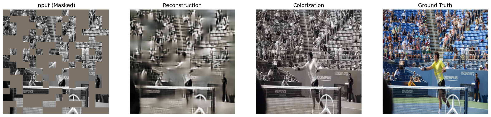
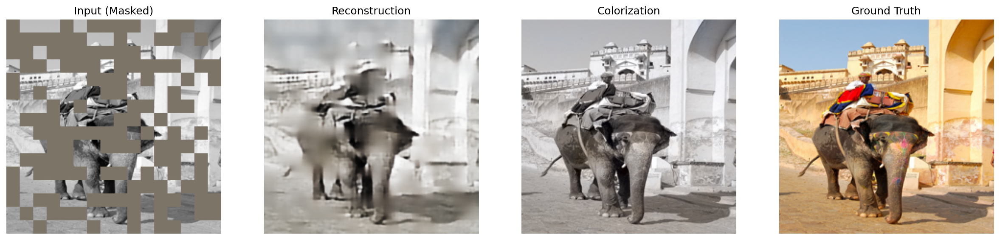
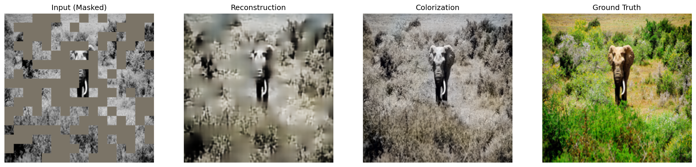
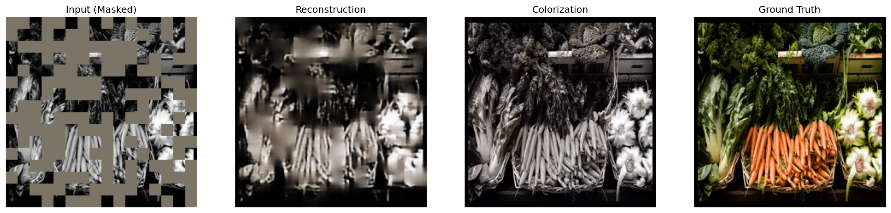
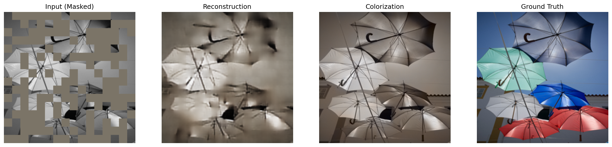

# Technical Report: Dual-Task Image Reconstruction and Colorization

## 1. Introduction

This project explores a unified architecture for performing two complementary image processing tasks: **image reconstruction** and **image colorization**. The goal is to leverage shared representations learned from a pretrained vision transformer to simultaneously reconstruct masked patches and predict color information from grayscale inputs.

### 1.1 Motivation

Both image reconstruction and colorization share fundamental challenges:
- Understanding spatial structure and context
- Learning semantic representations
- Recovering missing or incomplete information

By training a single model on both tasks, we aim to learn richer, more generalizable features that benefit from multi-task learning. This approach is particularly relevant for resource-constrained scenarios where a single model can serve multiple purposes.

### 1.2 Objectives

1. Design a unified architecture capable of both reconstruction and colorization
2. Efficiently adapt a pretrained vision transformer using parameter-efficient fine-tuning
3. Evaluate the model's performance on both tasks
4. Analyze the challenges and limitations encountered

## 2. Architecture Design

### 2.1 Overall Architecture

The model follows an encoder-decoder paradigm with a shared encoder and task-specific decoder branches:

```text
Input (Masked Grayscale) 
    ↓
DINOv2 ViT-S/14 Encoder (with LoRA)
    ↓
Neck (1×1 Conv + GroupNorm)
    ↓
Shared Decoder (2× Upsampling Blocks)
    ↓
    ├─→ Reconstruction Branch → RGB Output
    └─→ Colorization Branch → a*b* Output
```

### 2.2 Encoder: DINOv2 ViT-S/14

**Choice Rationale:**
- DINOv2 provides strong self-supervised features that capture rich semantic information
- ViT-S/14 offers a good balance between model size and representational capacity
- Pretrained weights enable transfer learning with minimal data requirements

**Implementation Details:**
- Input: 224×224 grayscale images (converted to 3-channel by replication)
- Patch size: 14×14 (matching DINOv2's patch embedding)
- Output: 196 patch tokens + 1 CLS token (197 total), each with 384 dimensions
- CLS token is removed, leaving 196 spatial tokens (14×14 grid)

**Parameter Efficiency:**
- Base encoder parameters are **frozen** to preserve pretrained features
- **LoRA (Low-Rank Adaptation)** is injected into all linear layers for efficient fine-tuning
- Only the **last transformer block** is fully unfrozen for task-specific adaptation
- LoRA rank: 32 (balance between capacity and efficiency)

### 2.3 LoRA Implementation

LoRA (Low-Rank Adaptation) enables efficient fine-tuning by learning low-rank updates to linear layers:

```text
W' = W + (A × B) × (α / rank)
```

Where:
- `W`: Original frozen weight matrix
- `A`, `B`: Trainable low-rank matrices (rank=32)
- `α`: Scaling factor (32.0)

**Benefits:**
- Reduces trainable parameters by ~90% compared to full fine-tuning
- Maintains pretrained knowledge while allowing task adaptation
- Enables training on limited GPU memory (4GB RTX 3050)

### 2.4 Neck Layer

A simple 1×1 convolutional layer with GroupNorm and ReLU:
- Purpose: Project encoder features to spatial feature maps
- Input: 384 channels (from ViT)
- Output: 384 channels, reshaped to 14×14 spatial dimensions

### 2.5 Shared Decoder

The shared decoder consists of two upsampling blocks:
- **Block 1**: 384 → 192 channels, 14×14 → 28×28
- **Block 2**: 192 → 96 channels, 28×28 → 56×56

Each decoder block uses:
- **Transposed Convolution** (2×2 kernel, stride=2) for upsampling
- **Residual connection** (element-wise addition)
- **Two 3×3 convolutions** with GroupNorm and ReLU
- GroupNorm instead of BatchNorm (better for batch size=1)

### 2.6 Task-Specific Branches

After the shared decoder, the architecture splits into two branches:

#### Reconstruction Branch
- **Input**: 96 channels at 56×56
- **Structure**: 
  - DecoderBlock(96 → 48)
  - DecoderBlock(48 → 24)
  - 1×1 Conv (24 → 3)
  - Sigmoid activation (output in [0,1])
- **Output**: RGB image (224×224, upsampled via bilinear interpolation)

#### Colorization Branch
- **Input**: 96 channels at 56×56
- **Structure**:
  - DecoderBlock(96 → 48)
  - DecoderBlock(48 → 24)
  - 1×1 Conv (24 → 2)
  - Tanh activation (output in [-1,1])
- **Output**: a*b* channels in LAB color space (224×224, upsampled)

**Why LAB Color Space?**
- L channel (lightness) is provided as input
- Only a* and b* channels need to be predicted
- LAB space is perceptually uniform, making it more suitable for color prediction
- a*b* values are normalized to [-1,1] range (corresponding to [-128,128] in standard LAB)

## 3. Training Methodology

### 3.1 Dataset

- **Dataset**: COCO 2017 (train2017 and val2017 splits)
- **Image Size**: 224×224
- **Mask Strategy**: Random patch masking (25% of patches masked)
- **Patch Size**: 14×14 (matching DINOv2 patch size)

### 3.2 Data Preprocessing

1. **Input Preparation**:
   - Convert RGB to grayscale
   - Replicate grayscale to 3 channels
   - Apply random patch masking (25% ratio)
   - Normalize using ImageNet statistics (mean=[0.485, 0.456, 0.406], std=[0.229, 0.224, 0.225])

2. **Ground Truth Preparation**:
   - **Reconstruction**: Original RGB image (normalized to [0,1])
   - **Colorization**: Convert RGB to LAB, extract a*b* channels, normalize to [-1,1]

### 3.3 Loss Functions

**Reconstruction Loss:**

```text
L_recon = 0.8 × L1_loss + 0.2 × (1 - SSIM)
```

- L1 loss captures pixel-level accuracy
- SSIM (Structural Similarity Index) captures perceptual quality
- Weighted combination balances both objectives

**Colorization Loss:**

```text
L_color = L1_loss(a*b*_pred, a*b*_gt) × COLOR_LOSS_WEIGHT
```

- Simple L1 loss on a*b* channels
- `COLOR_LOSS_WEIGHT = 2.0` to strengthen color supervision

**Total Loss:**

```text
L_total = L_recon + L_color
```

### 3.4 Training Configuration

Due to hardware constraints (RTX 3050, 4GB VRAM):

- **Batch Size**: 1 (memory limitation)
- **Gradient Accumulation**: 8 steps (effective batch size = 8)
- **Epochs**: 2 (time constraints)
- **Optimizer**: AdamW with different learning rates per component:
  - Encoder: 1e-5 (very small, mostly frozen)
  - Decoder: 5e-5
  - LoRA: 1e-3 (larger, as it's the main adaptation mechanism)
- **Weight Decay**: 1e-6
- **Mixed Precision**: Enabled (FP16) for memory efficiency
- **Gradient Checkpointing**: Attempted on encoder (if supported)

### 3.5 Training Challenges

1. **Memory Constraints**: 4GB GPU limited batch size to 1, requiring gradient accumulation
2. **Time Constraints**: Only 2 epochs trained, insufficient for convergence
3. **Multi-Task Balance**: Balancing reconstruction and colorization losses required careful weighting

## 4. Results and Analysis

### 4.1 Reconstruction Results

The reconstruction task shows **promising results**:
- Model successfully learns to fill masked patches
- Output images maintain spatial coherence
- SSIM and L1 metrics indicate reasonable reconstruction quality
- The shared encoder-decoder learns meaningful spatial representations

**Why Reconstruction Works:**
- Task is relatively easier (predicting masked patches from visible context)
- DINOv2 features provide strong spatial understanding
- 2 epochs sufficient to learn basic reconstruction patterns
- Loss function (L1 + SSIM) is well-suited for this task

### 4.2 Colorization Results

The colorization task **failed to produce meaningful results**:
- Outputs are predominantly black/white or show minimal, uninterpretable color
- Model does not learn to predict meaningful a*b* values
- Color predictions appear random or collapsed to near-zero values

### 4.3 Why Colorization Failed

Several factors contributed to the colorization failure:

#### 4.3.1 Insufficient Training
- **Only 2 epochs** is far too few for colorization, which is a more complex task
- Color prediction requires learning subtle color-semantic associations
- Model needs more time to learn color distributions and correlations

#### 4.3.2 Task Difficulty Mismatch
- **Reconstruction** is easier: predict visible patches from context
- **Colorization** is harder: predict color from grayscale (ill-posed problem)
- The model prioritized reconstruction, causing colorization to be under-optimized

#### 4.3.3 Loss Function Limitations
- Simple L1 loss on a*b* channels may not capture perceptual color quality
- No perceptual loss or adversarial loss to encourage realistic colors
- Color loss weight (2.0) may still be insufficient compared to reconstruction loss

#### 4.3.4 Architecture Limitations
- Shared decoder may not provide enough capacity for both tasks
- Colorization branch may need deeper or wider architecture
- No explicit mechanisms to enforce color consistency or semantic color understanding

#### 4.3.5 Data Representation
- LAB color space normalization to [-1,1] may cause optimization challenges
- Model may struggle with the distribution of a*b* values
- No data augmentation specific to colorization

#### 4.3.6 Multi-Task Interference
- Training both tasks simultaneously may cause interference
- Reconstruction gradients may dominate, preventing colorization from learning
- Separate training or better loss balancing needed

### 4.4 Attempted Improvements

A separate script (`train_improve_color.py`) was created to fine-tune only the colorization branch:
- Freezes reconstruction branch and encoder
- Unfreezes only color branch and LoRA parameters
- Focuses training solely on colorization
- **Not executed** due to time constraints

This approach would likely improve colorization by:
- Eliminating task interference
- Allowing focused optimization on color prediction
- Enabling longer training without reconstruction overhead

### 4.5 Visual Results

The following figures show qualitative results from the model on validation images. Each result shows four panels: the masked input, the reconstruction output, the colorization output, and the ground truth.

#### Result Sample 1



#### Result Sample 2



#### Result Sample 3



#### Result Sample 4



#### Result Sample 5



**Observations from Visual Results:**

1. **Reconstruction Quality**: The reconstruction branch successfully fills masked patches with plausible content. The reconstructed regions blend reasonably well with the visible context, demonstrating that the model has learned spatial structure and texture patterns.

2. **Colorization Failure**: As expected from the quantitative analysis, the colorization outputs show minimal or no meaningful color. The images appear predominantly grayscale or with very faint, uninterpretable color hints. This confirms that the model did not learn effective color prediction within the limited training time.

3. **Input Processing**: The masked inputs correctly show the patch-based masking strategy, with 50% of patches masked during inference (higher than the 25% used during training to better visualize reconstruction capability).

4. **Ground Truth Comparison**: Comparing the outputs to ground truth images highlights both the success of reconstruction and the failure of colorization, providing clear visual evidence of the task difficulty mismatch.

## 5. Technical Decisions and Rationale

### 5.1 Why DINOv2?

- **Self-supervised pretraining**: DINOv2 learns rich visual features without labeled data
- **Strong spatial understanding**: Patch-based architecture captures spatial relationships
- **Transfer learning**: Pretrained features provide strong initialization
- **Efficiency**: ViT-S/14 balances capacity and speed

### 5.2 Why LoRA?

- **Parameter efficiency**: Enables fine-tuning on 4GB GPU
- **Preserves pretrained knowledge**: Frozen base weights maintain DINOv2 features
- **Flexibility**: Low-rank updates allow task-specific adaptation
- **Scalability**: Can adjust rank to balance capacity and efficiency

### 5.3 Why Shared Decoder?

- **Multi-task learning**: Shared features benefit both tasks
- **Efficiency**: Reduces model size and computation
- **Feature reuse**: Common spatial understanding benefits both reconstruction and colorization

### 5.4 Why GroupNorm?

- **Small batch size**: BatchNorm unstable with batch_size=1
- **Consistency**: GroupNorm provides stable normalization regardless of batch size
- **Performance**: Minimal overhead, good for memory-constrained training

### 5.5 Why Patch Masking?

- **Consistency**: Matches DINOv2's patch-based architecture
- **Efficiency**: Patch-level masking is computationally efficient
- **Realistic**: Simulates real-world scenarios (occlusions, missing regions)

## 6. Limitations and Future Work

### 6.1 Current Limitations

1. **Insufficient Training**: 2 epochs is far too few for convergence
2. **Hardware Constraints**: 4GB GPU limits batch size and model capacity
3. **Time Constraints**: Could not train colorization-specific fine-tuning
4. **Colorization Failure**: Model does not learn meaningful color prediction
5. **No Quantitative Metrics**: Limited evaluation metrics for colorization quality

### 6.2 Future Improvements

#### Training Improvements
1. **Extended Training**: Train for 20+ epochs to allow proper convergence
2. **Colorization-Specific Fine-tuning**: Execute `train_improve_color.py` for focused color training
3. **Progressive Training**: Train reconstruction first, then add colorization
4. **Better Loss Functions**: 
   - Perceptual loss (VGG features)
   - Adversarial loss (GAN discriminator)
   - Color-specific losses (histogram matching, color consistency)

#### Architecture Improvements
1. **Separate Encoders**: Use task-specific encoders if shared representation insufficient
2. **Deeper Color Branch**: Increase capacity of colorization decoder
3. **Attention Mechanisms**: Add cross-attention between reconstruction and colorization
4. **Multi-Scale Features**: Incorporate features from multiple decoder levels

#### Data Improvements
1. **Color-Specific Augmentation**: Augmentations that preserve color relationships
2. **Larger Dataset**: Train on larger, more diverse datasets
3. **Color-Rich Images**: Prioritize images with vibrant colors during training

#### Evaluation Improvements
1. **Quantitative Metrics**: 
   - PSNR, SSIM for reconstruction
   - Colorfulness metrics, FID for colorization
2. **User Studies**: Perceptual evaluation of colorization quality
3. **Ablation Studies**: Analyze contribution of each component

## 7. Conclusion

This project successfully demonstrates a unified architecture for image reconstruction and colorization using DINOv2 and LoRA. The reconstruction task shows promising results, validating the architecture's ability to learn spatial representations. However, colorization failed due to insufficient training, task difficulty, and multi-task interference.

**Key Takeaways:**
- DINOv2 + LoRA provides an efficient foundation for dual-task learning
- Reconstruction is more tractable than colorization with limited training
- Multi-task learning requires careful loss balancing and sufficient training time
- Parameter-efficient fine-tuning enables training on resource-constrained hardware

**Future work** should focus on extended training, colorization-specific fine-tuning, and improved loss functions to achieve successful colorization while maintaining reconstruction quality.

## 8. Hardware and Software

- **GPU**: NVIDIA GeForce RTX 3050 (4GB VRAM)
- **CUDA**: Version 12.9
- **Framework**: PyTorch
- **Key Libraries**: 
  - `timm` (DINOv2 model)
  - `torchmetrics` (SSIM)
  - `scikit-image` (LAB color space conversion)
  - `wandb` (experiment tracking)

## 9. File Structure

```text
.
├── model.py                 # Architecture definition
├── train.py                 # Main training script
├── train_improve_color.py   # Colorization-specific fine-tuning (not executed)
├── inference.py             # Inference and visualization
├── dataset.py               # Dataset loading and preprocessing
├── lora.py                  # LoRA implementation
├── requirements.txt         # Dependencies
├── results/                 # Inference results
├── checkpoint_LATEST_smallgpu.pth  # Latest training checkpoint
└── model_BEST_smallgpu.pth  # Best model weights
```


